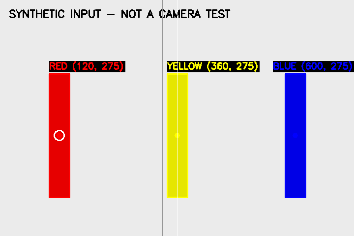
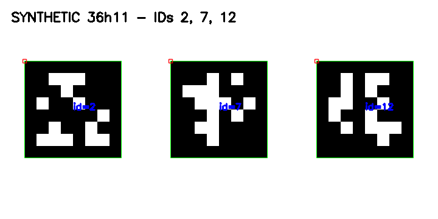

# Underwater ROV Vision

Two Python/OpenCV programs for a human ROV operator. One collects AprilTag IDs and locates the selected tag in the current image. The other highlights red, yellow and blue pole candidates and shows their horizontal offset. Both can run on a camera or process a single image offline.

## Project overview and motivation

A propulsion fault limited vehicle integration during an underwater robotics training project. The two vision programs can be run and evaluated independently of the vehicle.

## My contributions

I developed and debugged both prototypes with AI assistance. I worked on the scan and confirmation logic, the operator displays, HSV threshold tuning and contour filtering. OpenCV supplies the tag decoder and image-processing primitives. The later packaging, offline examples, regression tests and documentation also used AI assistance.

## Implemented features and technical approach

**AprilTags.** A tag must appear in five consecutive frames before its ID enters the scan history. With exactly three distinct IDs, the operator can lock the minimum or maximum ID. The program compares that ID with the current detections and displays its position in horizontal image thirds. Removing the chosen tag changes its visibility to `LOST` while preserving the selection. Duplicate matches produce `AMBIGUOUS`. Supported families are `36h11`, `36h10`, `25h9` and `16h5`.

**Color poles.** The program combines HSV bands for each color, including two hue ranges for red. It filters external contours by area, height-to-width ratio and fill ratio, then marks the largest surviving candidate per color. For the active target it reports the bounding-box center and signed horizontal error in pixels. A 30-pixel tolerance on either side of the image center controls the alignment label. Trackbars expose the masks and rejection reasons. The operator enters a target order and confirms each transition manually.

## Demo

These previews were generated by running the image commands below on synthetic inputs.





## Installation and usage

Windows PowerShell, from the repository root. The tested environment uses Python 3.12, OpenCV 4.12.0 and NumPy 2.2.6.

```powershell
py -3.12 -m venv .venv
.\.venv\Scripts\python.exe -m pip install -r requirements.txt
.\.venv\Scripts\python.exe run.py color --order R-B-Y --image examples/synthetic/color_poles.png --output outputs/color
.\.venv\Scripts\python.exe run.py apriltag --mode min --family 36h11 --image examples/synthetic/apriltags.png --output outputs/apriltag
```

Both image commands write an annotated PNG and a JSON result to the selected directory. A single tag image yields decoded IDs. Five-frame confirmation runs in camera mode.

```powershell
.\.venv\Scripts\python.exe run.py apriltag --camera 0 --family 36h11 --mode min
.\.venv\Scripts\python.exe run.py color --camera 0 --order R-B-Y
.\.venv\Scripts\python.exe -m unittest discover -s tests -v
```

Select the camera index for the intended lens. The Windows launchers `Start_AprilTag.cmd` and `Start_Color.cmd` use the local virtual environment. Click the image window before using keyboard controls.

| Module | Controls |
|---|---|
| AprilTag | Enter to lock and save, S for a screenshot, R for a new round, Q or Esc to quit |
| Color poles | N to advance, U to undo, P to print the frame result, S to save settings, D for code defaults, Q to quit |

For tuning, copy `configs/mission5.json` to a separate file and pass it with `--config`. Saving writes to the selected file. [Parameter history](configs/README.md)

## Testing and observations

The regression suite covers marker decoding, scan-state transitions, color masks, shape rejection, manual sequencing, file I/O and CLI behavior. The earlier saved color profile and the tuned profile show two practical adjustments: yellow saturation minimum increased from 100 to 150, and blue hue minimum decreased from 100 to 85. Indoor trials reported occasional loss with more distant or tilted targets. [Test record](TESTING.md)

## Known limitations and project status

| Status | Scope |
|---|---|
| Verified | Software behaviors in the recorded regression suite and offline image examples |
| Partially verified | Indoor use of both modules was reported. The public examples use generated inputs. |
| Not tested in the published evaluation | Underwater recognition and complete vehicle integration |
| Not implemented | Autonomous navigation, calibrated range or pose, thruster commands and automatic strike confirmation |

Similar-colored backgrounds can pass the contour filters. An axis-aligned box around a tilted pole can fail the height-to-width threshold. Scan history can retain a target after it leaves the frame. The available evidence supports image-space guidance. Final competition acceptance is undocumented in this release.

## Future improvements

Evaluate the current thresholds on labeled raw target and distractor frames across lighting and tilt conditions. A comparison with a rotation-tolerant shape filter would help establish when the current filter loses valid targets.
